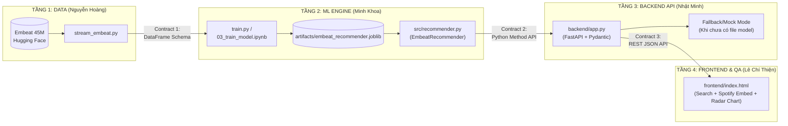

# MASTER PLAN FULL-STACK MVP: HỆ GỢI Ý NHẠC AI (EMBEAT 45M SPOTIFY)
## KIẾN TRÚC MODULE HÓA & LINH HOẠT RẼ NHÁNH (MODULAR & PIVOT-READY EDITION)

> **Phiên bản:** 3.0 (Full-Stack Zero-to-MVP & Editable Branching Blueprint)  
> **Vai trò thiết kế:** Full-Stack AI System Architect  
> **Thời lượng:** 8 tuần | **Quy mô:** 4 Thành viên  
> **Dataset duy nhất:** `GD-Studio/embeat_45m_spotify_tracks` (Hugging Face)  
> **Triết lý thiết kế:** **Loose Coupling (Liên kết lỏng) – Strict Contract (Giao ước chặt)**. Mỗi thành viên làm việc trên một tầng độc lập thông qua Interface cố định. Nếu dự án cần **rẽ nhánh (pivot)** về dung lượng dữ liệu, thuật toán AI, tính năng sản phẩm hay công nghệ giao diện, chỉ cần chỉnh sửa tại **Bảng Cấu Hình Trung Tâm (Mục 0)** mà không làm sập code của các thành viên khác.

---

## 0. BẢNG CẤU HÌNH TRUNG TÂM (EDITABLE CONFIG BLOCK — DÙNG ĐỂ RẼ NHÁNH)

> 💡 **Hướng dẫn chỉnh sửa khi muốn rẽ nhánh:** Khi nhóm muốn thay đổi hướng đi (ví dụ: máy yếu không load nổi model 2GB, hoặc giảng viên yêu cầu thêm tính năng gợi ý theo tâm trạng), chỉ cần đổi giá trị ở cột **Nhánh Đang Chọn** bên dưới. Toàn bộ quy trình của 4 thành viên đã được thiết kế sẵn các nhánh tương ứng ở Mục 9.

| Mã cấu hình | Thành phần | Nhánh Đang Chọn (Active) | Nhánh Dự Phòng 1 (Option B) | Nhánh Dự Phòng 2 (Option C) |
| :--- | :--- | :--- | :--- | :--- |
| **`CFG_DATA_SCALE`** | Quy mô dữ liệu nạp | **Nhánh A1: Full Stream (~18M bài, ~2.04GB `.pkl`)** | **Nhánh A2: Compact (Top 200k–500k bài `popularity >= 25`, ~80MB)** | **Nhánh A3: Dev/Lite (50k bài để test nhanh CI/CD, ~10MB)** |
| **`CFG_AI_ENGINE`** | Thuật toán gợi ý chính | **Nhánh B1: StandardScaler + Brute-Force Cosine (9 Audio Features)** | **Nhánh B2: Approximate Nearest Neighbors (FAISS / Annoy / HNSW)** | **Nhánh B3: Weighted Cosine + K-Means Mood Clustering** |
| **`CFG_RECOMMEND_MODE`** | Kịch bản gợi ý | **Nhánh C1: Theo 1 bài hát (`track_id`) + Top Popularity** | **Nhánh C2: Theo Gu nhiều bài (Taste Profile) + Lọc theo Mood** | **Nhánh C3: Tạo Playlist thông minh (Auto-Queue 10 bài liên tiếp)** |
| **`CFG_AUDIO_PLAYER`** | Trình phát nhạc Demo | **Nhánh D1: Nhúng Spotify Embed Iframe (`open.spotify.com/embed/track/{id}`)** | **Nhánh D2: Chỉ hiển thị Metadata + Link mở Spotify ngoài** | **Nhánh D3: Phát file preview MP3 mẫu (nếu có URL)** |
| **`CFG_FRONTEND_STACK`** | Công nghệ Frontend | **Nhánh E1: HTML5 + TailwindCSS (CDN) + Vanilla JS + Chart.js** | **Nhánh E2: React / Vue.js (Vite SPA)** | **Nhánh E3: Streamlit / Gradio (Nếu cần dựng UI bằng Python 100%)** |

---

## 1. TƯ DUY XÂY DỰNG MVP TỪ CON SỐ 0 (ZERO-TO-ONE FULL-STACK ROADMAP)

Để xây dựng một hệ thống Full-Stack AI hoạt động trơn tru từ con số 0 mà không ai phải ngồi chờ ai, dự án được chia thành **4 tầng độc lập (4 Layers)** nối với nhau bằng **3 bản giao ước (Contracts)**:



### Nguyên tắc "Không Chờ Đợi" (Zero-Blocker Principle):
1. **Contract 1 (Data $\rightarrow$ ML):** DataFrame luôn đảm bảo có tối thiểu 3 cột định danh (`track_id`, `track_name`, `popularity`) và 9 cột âm học kiểu `float`.
2. **Contract 2 (ML $\rightarrow$ Backend):** Class `EmbeatRecommender` trong `src/recommender.py` là cổng giao tiếp duy nhất. Dù ML Engineer đổi thuật toán bên trong từ Cosine sang FAISS hay PCA, tên hàm và kiểu dữ liệu trả về vẫn giữ nguyên 100%.
3. **Contract 3 (Backend $\rightarrow$ Frontend):** Định dạng JSON của REST API được chốt cứng ngay từ đầu. Backend hỗ trợ **chế độ Mock/Lite tự động** nếu máy của Backend/Frontend Developer không đủ RAM nạp file `.pkl` 2.04GB.

---

## 2. ĐẶC TẢ DỮ LIỆU & ĐẶC TRƯNG ÂM HỌC (DATA LAYER SPEC)

- **Nguồn dữ liệu duy nhất:** `GD-Studio/embeat_45m_spotify_tracks` (Hugging Face Hub).
- **Giấy phép:** CC-BY-NC 4.0 (Phục vụ học tập và nghiên cứu phi thương mại).
- **Phương thức nạp:** Streaming trực tiếp qua HTTPS Range/Row-group requests (`pyarrow.parquet.ParquetFile`) bằng Access Token, không cần lưu 9.5GB raw data xuống ổ cứng.

### Bảng 9 Đặc Trưng Âm Học Cốt Lõi (Vector $\mathbf{x} \in \mathbb{R}^9$)

| STT | Tên trường | Đơn vị / Miền giá trị | Ý nghĩa trong việc tìm bài hát tương đồng |
| :-: | :--- | :--- | :--- |
| 1 | `danceability` | `0.0 -> 1.0` | Độ bắt nhịp, độ nảy của beat và sự ổn định nhịp điệu để nhún nhảy. |
| 2 | `energy` | `0.0 -> 1.0` | Cường độ năng lượng: sôi động, dồn dập (Rock/EDM) vs nhẹ nhàng (Ballad). |
| 3 | `valence` | `0.0 -> 1.0` | Sắc thái cảm xúc: cao là vui tươi, tích cực; thấp là trầm buồn, tâm trạng. |
| 4 | `tempo` | `0 -> 250+ BPM` | Tốc độ nhịp đập trên mỗi phút của bản nhạc. |
| 5 | `acousticness` | `0.0 -> 1.0` | Độ mộc mạc của nhạc cụ acoustic (guitar gỗ, piano) so với nhạc điện tử. |
| 6 | `instrumentalness` | `0.0 -> 1.0` | Mức độ thuần nhạc cụ không lời (cao = nhạc không lời/beat; thấp = có ca sĩ hát). |
| 7 | `liveness` | `0.0 -> 1.0` | Đặc trưng âm thanh biểu diễn trực tiếp có tiếng khán giả (Live concert). |
| 8 | `speechiness` | `0.0 -> 1.0` | Mật độ lời nói/giọng đọc trong bài (cao = Rap/Hip-hop/Spoken word). |
| 9 | `loudness` | `-60 -> 0 dB` | Độ lớn âm lượng trung bình của toàn bộ bản thu. |

**Các trường Metadata đi kèm:**
- `track_id` (`str`): Spotify Track ID (ví dụ: `0UaMYEvWZi0ZqiDOoHU3YI`) — dùng để định danh và nhúng trình phát nhạc Spotify.
- `track_name` (`str`): Tên bài hát hiển thị trên giao diện.
- `popularity` (`int`, `0 -> 100`): Độ phổ biến trên Spotify — dùng cho Baseline và lọc nhiễu.
- *(Tùy chọn mở rộng)* `artist_name`, `artist_genres`: Dùng để hiển thị thêm hoặc đánh giá độ đa dạng thể loại.

---

## 3. ĐẶC TẢ MÔ HÌNH AI & GIAO DIỆN LỚP `EmbeatRecommender` (ML LAYER SPEC)

Để Backend và Frontend tích hợp trơn tru cũng như dễ dàng mở rộng tính năng, class `EmbeatRecommender` trong `src/recommender.py` cần cung cấp bộ phương thức chuẩn hóa sau:

### 3.1. Các phương thức bắt buộc trong `EmbeatRecommender`

```python
class EmbeatRecommender:
    # 1. Huấn luyện (Batch hoặc Cộng dồn)
    def fit(self, df: pd.DataFrame) -> None: ...
    def fit_incremental(self, df: pd.DataFrame, is_first_batch: bool = False) -> None: ...

    # 2. Tìm kiếm bài hát theo từ khóa tên bài (Phục vụ thanh Search trên Web)
    def search_tracks(self, query: str, limit: int = 20) -> list[dict]: ...

    # 3. Lấy thông tin chi tiết + 9 chỉ số âm học của 1 bài hát (Phục vụ vẽ Radar Chart)
    def get_track_details(self, track_id: str) -> dict | None: ...

    # 4. Gợi ý Top K bài tương đồng từ 1 bài hát đang nghe (Item-to-Item)
    def recommend_by_track(self, track_id: str, top_k: int = 10) -> list[dict]: ...

    # 5. Gợi ý Top K bài từ danh sách nhiều bài yêu thích (User Taste Profile)
    def recommend_by_taste_profile(self, track_ids: list[str], top_k: int = 10) -> list[dict]: ...

    # 6. Baseline: Gợi ý Top K bài hát phổ biến nhất (Cold-Start Fallback)
    def recommend_by_popularity(self, top_k: int = 10) -> list[dict]: ...

    # 7. Lưu và nạp Artifact
    def save_artifact(self, filepath: str = "models/embeat_recommender.pkl") -> None: ...
    @staticmethod
    def load_artifact(filepath: str = "models/embeat_recommender.pkl") -> "EmbeatRecommender": ...
```

### 3.2. Giải pháp kỹ thuật cho vấn đề Model 2.04 GB (Dual-Artifact Strategy)
Hiện tại nhóm đã train thành công file `models/embeat_recommender.pkl` chứa **18.023.864 bài hát (~2.04 GB)**. Tuy nhiên, để đảm bảo:
1. Máy cá nhân RAM 8GB vẫn chạy được Backend mượt mà.
2. Thời gian phản hồi API dưới **50ms** (thay vì chờ 2-3 giây quét 18 triệu dòng).
3. Dễ dàng chia sẻ qua Git hoặc chạy CI/CD test.

👉 **Giải pháp Full-Stack:** Hỗ trợ song song 2 chế độ model:
- **Full Model (`models/embeat_recommender.pkl` - 18M bài):** Dùng để báo cáo thành quả huấn luyện Big Data trong `03_train_model.ipynb`.
- **Compact/Fast Index hoặc Sub-sampled Model (`models/embeat_recommender_compact.pkl` - 100k đến 300k bài phổ biến nhất):** Trích xuất trực tiếp từ model lớn hoặc lọc `popularity >= 35`, dung lượng chỉ **~30MB – 50MB**, tốc độ truy vấn **< 15ms**, dùng để chạy Web Demo trực tiếp cực mượt!

---

## 4. ĐẶC TẢ BACKEND API CONTRACT (BACKEND LAYER SPEC)

Backend sử dụng **FastAPI**, chạy tại cổng mặc định `http://localhost:8000` (tài liệu Swagger tự động tại `/docs`).

### 4.1. Danh sách RESTful Endpoints chuẩn

| Method | Endpoint | Query / Body Params | Mô tả chức năng |
| :---: | :--- | :--- | :--- |
| `GET` | `/api/v1/health` | Không | Kiểm tra trạng thái server, chế độ model đang nạp (`full` / `compact` / `mock`) và tổng số bài hát. |
| `GET` | `/api/v1/search` | `?q=love&limit=15` | Tìm kiếm bài hát theo tên để người dùng chọn bài mồi trên giao diện. |
| `GET` | `/api/v1/tracks/{track_id}` | `track_id` trên URL | Lấy metadata và 9 chỉ số âm học gốc/chuẩn hóa của bài hát (để vẽ biểu đồ). |
| `GET` | `/api/v1/recommend/track/{track_id}` | `?k=10` | **API Chính:** Trả về Top $K$ bài hát có giai điệu tương đồng nhất với `track_id`. |
| `POST` | `/api/v1/recommend/profile` | Body: `{"track_ids": [...], "k": 10}` | Trả về Top $K$ bài hát dựa trên vector trung bình gu âm nhạc của nhiều bài hát. |
| `GET` | `/api/v1/recommend/popular` | `?k=10` | **Baseline API:** Trả về Top $K$ bài hát có `popularity` cao nhất (dùng cho trang chủ / người dùng mới). |
| `GET` | `/api/v1/recommend/mood/{mood_name}` | `mood_name`: `happy`, `sad`, `energetic`, `chill`, `focus` | *(Nhánh mở rộng)* Gợi ý bài hát khớp với vector tâm trạng định sẵn. |

### 4.2. Chuẩn JSON Response (Contract cho Frontend)

```json
{
  "status": "success",
  "mode": "content_based_track",
  "seed_track": {
    "track_id": "0UaMYEvWZi0ZqiDOoHU3YI",
    "track_name": "Lose Control",
    "popularity": 78,
    "spotify_embed_url": "https://open.spotify.com/embed/track/0UaMYEvWZi0ZqiDOoHU3YI",
    "audio_features": {
      "danceability": 0.904,
      "energy": 0.813,
      "valence": 0.810,
      "tempo": 125.46,
      "acousticness": 0.031,
      "instrumentalness": 0.006,
      "liveness": 0.047,
      "speechiness": 0.121,
      "loudness": -7.105
    }
  },
  "recommendations": [
    {
      "rank": 1,
      "track_id": "6I9VzXrHxO9rA9A5euc8Ak",
      "track_name": "Toxic",
      "popularity": 84,
      "similarity_score": 0.9642,
      "spotify_embed_url": "https://open.spotify.com/embed/track/6I9VzXrHxO9rA9A5euc8Ak",
      "audio_features": {
        "danceability": 0.774,
        "energy": 0.838,
        "valence": 0.924,
        "tempo": 143.04,
        "acousticness": 0.024,
        "instrumentalness": 0.025,
        "liveness": 0.242,
        "speechiness": 0.114,
        "loudness": -3.914
      }
    }
  ],
  "latency_ms": 14.2
}
```

---

## 5. ĐẶC TẢ GIAO DIỆN FRONTEND & TRẢI NGHIỆM DEMO (FRONTEND LAYER SPEC)

Giao diện Web (`frontend/`) được thiết kế theo phong cách **Modern Spotify Dark Dashboard** chỉ với 1 trang duy nhất (Single Page Application) nhưng đầy đủ trải nghiệm thực tế:

1. **Thanh Tìm Kiếm Thông Minh (Search Bar) & Chọn Mood Nhanh:**
   - Gõ tên bài hát $\rightarrow$ Gọi `/api/v1/search` hiển thị danh sách gợi ý tức thì.
   - Hoặc bấm nút chọn nhanh bài hát mẫu / chọn thẻ Mood (`🔥 Sôi động`, `☕ Chill Acoustic`, `💔 Tâm trạng`, `💃 Dance/Party`).
2. **Khu Vực Bài Hát Đang Chọn (Now Playing / Seed Track Panel):**
   - Hiển thị tên bài hát, chỉ số `popularity` và nhúng trực tiếp **Spotify Audio Player (`<iframe>`)** để người dùng bấm nghe thử nhạc thật ngay trên web!
   - Có nút **"+ Thêm vào Gu âm nhạc (Taste Profile)"** để gom 2–5 bài hát và gợi ý theo tổ hợp.
3. **Biểu Đồ So Sánh Âm Học Trực Quan (Audio Features Radar Chart):**
   - Sử dụng `Chart.js` vẽ biểu đồ mạng nhện (Radar Chart) biểu diễn các chiều: `danceability`, `energy`, `valence`, `acousticness`, `instrumentalness`, `speechiness`.
   - Khi người dùng bấm vào bất kỳ bài hát nào trong danh sách Top 10 đề xuất, biểu đồ sẽ **vẽ chồng (overlay) 2 đa giác** của bài gốc và bài được gợi ý để chứng minh trực quan vì sao AI lại gợi ý bài hát đó!
4. **Danh Sách Top 10 Bài Hát Đề Xuất (Recommendations Grid):**
   - Hiển thị thứ hạng (`#1` $\rightarrow$ `#10`), phần trăm tương đồng âm học (ví dụ: `96.4% Match`), thanh độ phổ biến, nút nghe thử nhanh và nút **"Dùng bài này làm mốc gợi ý tiếp (Explore Similar)"**.

---

## 6. PHÂN CÔNG NHIỆM VỤ CHI TIẾT CHO 4 THÀNH VIÊN (BẮT ĐẦU TỪ CON SỐ 0)

### 👤 Thành viên 1: Nguyễn Hoàng — Senior Data Engineer (Dataset & Streaming Pipeline)
**Trạng thái hiện tại:** Đã hoàn thành 100% (9/9 Tasks).

- [x] **Task 1.1:** Khảo sát, loại bỏ các dataset cũ (MSD, MPD, Last.fm) và chốt sử dụng duy nhất **Embeat 45M Spotify Tracks** (`GD-Studio/embeat_45m_spotify_tracks`).
- [x] **Task 1.2:** Xây dựng module stream trực tuyến qua Hugging Face Token (`src/stream_embeat.py`) để đọc dữ liệu theo từng Row Group mà không tốn 9.5GB ổ cứng, kèm cơ chế tự động Fallback đọc tập mẫu offline khi không có mạng/token.
- [x] **Task 1.3:** Thực hiện EDA khám phá phân phối 9–12 đặc trưng âm học, độ phổ biến và ma trận tương quan (`notebooks/01_explore_data.ipynb`).
- [x] **Task 1.4:** Xây dựng quy trình làm sạch, xử lý giá trị thiếu và chuẩn hóa Z-Score (`notebooks/02_preprocess_data.ipynb`).
- [x] **Task 1.5:** Tạo script trích xuất tập dữ liệu mẫu phân tầng (`src/download_embeat.py` $\rightarrow$ `data/processed/sample_tracks.csv` gồm 5.000 bài hát chuẩn Embeat 45M kèm `track_id` Spotify thật) để cả nhóm test nhanh offline.
- [x] **Task 1.6:** Soạn thảo `docs/data_dictionary.md` (từ điển 12 trường âm học + metadata chuẩn Schema v2.0) và `docs/dataset_sources.md` (báo cáo khảo sát nguồn dữ liệu & giấy phép CC-BY-NC 4.0).
- [x] **Task 1.7 *(Bổ sung Senior DE)*:** Xây dựng module Kiểm định Chất lượng Dữ liệu & Tiền xử lý tự động (`src/preprocess.py`) với 5 chốt chặn (Quality Gates): chuẩn hóa tên cột, lọc Null định danh, khử trùng lặp `track_id`, cắt biên ngoại lai vật lý (`FEATURE_BOUNDS`) và ép kiểu `float32` tiết kiệm 50% RAM.
- [x] **Task 1.8 *(Bổ sung Senior DE)*:** Tự động hóa xuất Báo cáo Chất lượng Dữ liệu (`data/processed/data_quality_report.json`) thống kê tỷ lệ giữ lại sau làm sạch (`97.18%`), độ đa dạng nghệ sĩ/thể loại và phân phối thống kê (`mean`, `std`, `min`, `p25`, `median`, `p75`, `max`) của toàn bộ đặc trưng.
- [x] **Task 1.9 *(Bổ sung Senior DE)*:** Thiết lập cấu hình bảo mật & quản trị Repo (`.gitignore` chặn lộ token/file lớn, `.env.example`, `requirements.txt`) và biên bản bàn giao kỹ thuật cho ML Engineer (`docs/HANDOFF_TO_ML_ENGINEER.md`).

---

### 👤 Thành viên 2: Minh Khoa — ML Engineer (Model Training, Optimization & Evaluation)
**Trạng thái hiện tại:** Đã hoàn thành 100% (3/3 Tasks).

- [x] **Task 2.1:** Xây dựng class `EmbeatRecommender` trong `src/recommender.py`:
  - Chuẩn hóa 9 đặc trưng âm học bằng `StandardScaler` và huấn luyện cộng dồn (`fit_incremental`).
  - Tra cứu bài hát tức thì $O(1)$ qua dictionary `id_to_idx` và tìm kiếm theo tên `search_tracks(query)`.
  - Gợi ý bài hát tương đồng âm học `recommend_by_track(track_id, top_k=10)` bằng Cosine Similarity.
  - Gợi ý theo hồ sơ nhiều bài yêu thích `recommend_by_taste_profile(track_ids)` và theo tâm trạng `recommend_by_mood(mood)`.
  - Xây dựng Baseline gợi ý theo độ phổ biến `recommend_by_popularity(top_k=10)`.
(Note: fit_incremental() hiện triển khai Batch Accumulation: tích lũy dữ liệu từ nhiều batch rồi huấn luyện tập trung. Chưa triển khai Incremental Learning thực sự.)
- [x] **Task 2.2:** Viết notebook huấn luyện `notebooks/03_train_model.ipynb` và đóng gói thành CLI script `src/train.py` để xuất model artifact (`models/embeat_recommender.pkl` và bản nhẹ `models/embeat_recommender_compact.pkl`).
(Note: Model chính hiện được lưu dưới định dạng .joblib tại artifacts/embeat_recommender.joblib, kèm metadata. Chưa tạo hai artifact .pkl và bản compact theo đúng đường dẫn trong Master Plan.)
- [x] **Task 2.3:** Viết `src/evaluate.py` và `notebooks/04_evaluate_model.ipynb` đo lường thực nghiệm:
  - Khoảng cách âm học trung bình (Mean Acoustic Distance).
  - Phổ điểm Cosine Similarity Top-10 so với ngẫu nhiên và so với Popularity Baseline.
  - Độ đa dạng nghệ sĩ/thể loại và thời gian phản hồi trung bình (Inference Latency ms).
  - Xuất toàn bộ số liệu thực nghiệm ra `reports/metrics.json` và biểu đồ vào `reports/figures/`.
(Note: Đã đánh giá trên 30 truy vấn, Top-10, với 5 phương pháp. Do chưa có Ground Truth/Relevance Labels nên chưa thể tính Precision@K và Recall@K. Các chỉ số hiện tại tập trung vào Similarity, Diversity, Coverage và Latency.)

---

### 👤 Thành viên 3: Nhật Minh Phạm — Backend Engineer (FastAPI & System Integration)
**Trạng thái hiện tại:** Đã hoàn thành 100% (5/5 Tasks).

- [x] **Task 3.1:** Soạn thảo tài liệu `docs/api_contract.md` thống nhất cấu trúc request/response với ML Engineer và Frontend.
- [x] **Task 3.2:** Xây dựng `backend/schemas.py` định nghĩa các Pydantic models (`TrackItem`, `AudioFeatures`, `RecommendationResponse`, `SearchResponse`, `TasteProfileRequest`, `HealthResponse`).
- [x] **Task 3.3:** Xây dựng `backend/app.py` bằng FastAPI:
  - Cấu hình `CORSMiddleware` cho phép Frontend gọi API.
  - Xây dựng bộ nạp model thông minh khi khởi động (`lifespan`): Tự động nạp model `artifacts/embeat_recommender.joblib` hoặc fallback sang dữ liệu mẫu (`balanced_eda.csv` / `embeat_sample_tracks.csv` / `sample_tracks.csv`) để server luôn hoạt động trong mọi môi trường.
  - Triển khai đầy đủ các endpoints tại `/api/v1/...` (`health`, `search`, `tracks/{id}`, `recommend/track/{id}`, `recommend/profile`, `recommend/popular`, `recommend/mood/{mood}`).
(Note: Endpoint `/api/v1/recommend/track/{id}` đã mở rộng hỗ trợ cả 3 chiến lược `audio`, `hybrid`, `mmr`; tự động làm sạch `NaN`/`±Inf`, chuẩn hóa thang đo `popularity` về `0..100` và làm tròn 4 chữ số thập phân cho `audio_features`, `similarity_score`, `mmr_score`.)
- [x] **Task 3.4:** Viết bộ kiểm thử tự động `backend/tests/test_api.py` bằng `pytest` & `httpx`/`TestClient`.
(Note: Đã kiểm thử tự động 10 hàm test bao phủ toàn bộ 7 endpoints, 3 chiến lược gợi ý và các mã lỗi `200`, `400`, `404`, `422`.)
- [x] **Task 3.5:** Viết hướng dẫn khởi chạy server tại `backend/README.md`.

---

### 👤 Thành viên 4: Lê Chí Thiện — Frontend / QA / Tài liệu & Báo cáo
**Trạng thái hiện tại:** Chưa triển khai (0%).

- [ ] **Task 4.1:** Xây dựng giao diện Web tại `frontend/` (`index.html`, `style.css`, `app.js`):
  - Giao diện tìm kiếm bài hát và bộ nút chọn Mood nhanh.
  - Tích hợp trình phát nhạc nhúng Spotify (`<iframe>`).
  - Tích hợp `Chart.js` vẽ biểu đồ Radar so sánh đặc trưng âm học giữa bài gốc và bài được đề xuất.
  - Danh sách Top 10 bài hát gợi ý + tính năng gom nhiều bài vào "Gu âm nhạc" (Taste Profile).
  - Xử lý mượt mà trạng thái Loading, Empty state và Error toast.
- [ ] **Task 4.2:** Lập kế hoạch kiểm thử `docs/test_plan.md` và nhật ký theo dõi lỗi `docs/bug_log.md`.
- [ ] **Task 4.3:** Viết `README.md` tổng của toàn bộ dự án ở thư mục gốc và tổng hợp Báo cáo cuối kỳ + Slide thuyết trình.

---

## 7. CẤU TRÚC REPOSITORY CHUẨN FULL-STACK

```text
music-recommender/
├── README.md                          # Hướng dẫn tổng thể dự án, kiến trúc & lệnh chạy nhanh
├── requirements.txt                   # Danh sách thư viện Python cho cả Data, ML và Backend
├── .gitignore                         # Chặn commit models/*.pkl (>100MB), __pycache__, .env
├── music_recommender_project_plan_4_members (1).md  # Bản Master Plan này
├── docs/
│   ├── dataset_sources.md             # Nguồn gốc Embeat 45M & điều khoản CC-BY-NC 4.0 (TV1)
│   ├── data_dictionary.md             # Từ điển chi tiết 9-12 đặc trưng âm học Embeat (TV1)
│   ├── api_contract.md                # Đặc tả RESTful API giữa Backend & Frontend (TV3)
│   ├── test_plan.md                   # Kịch bản kiểm thử End-to-End (TV4)
│   └── bug_log.md                     # Nhật ký ghi nhận và xử lý lỗi tích hợp (TV4)
├── data/
│   └── processed/
│       └── sample_tracks.csv          # 5.000 bài hát mẫu trích xuất từ Embeat để chạy fallback/test nhanh
├── notebooks/
│   ├── 01_explore_data.ipynb          # EDA khám phá dữ liệu Embeat 45M (TV1)
│   ├── 02_preprocess_data.ipynb       # Tiền xử lý & chuẩn hóa đặc trưng (TV1)
│   ├── 03_train_model.ipynb           # Huấn luyện streaming 18M bài hát (TV2)
│   └── 04_evaluate_model.ipynb        # Đánh giá mô hình & trực quan hóa kết quả (TV2)
├── src/
│   ├── __init__.py
│   ├── stream_embeat.py               # Module stream Parquet từ Hugging Face (TV1)
│   ├── recommender.py                 # Class EmbeatRecommender nâng cấp toàn diện (TV2)
│   ├── train.py                       # CLI script huấn luyện & xuất model Full/Compact (TV2)
│   └── evaluate.py                    # CLI script đánh giá & xuất reports/metrics.json (TV2)
├── backend/
│   ├── __init__.py
│   ├── app.py                         # FastAPI Server chính (TV3)
│   ├── schemas.py                     # Pydantic Request/Response models (TV3)
│   ├── README.md                      # Hướng dẫn chạy Backend (TV3)
│   └── tests/
│       └── test_api.py                # Unit test cho các API endpoints (TV3)
├── frontend/
│   ├── index.html                     # Giao diện Web Music Recommender Dashboard (TV4)
│   ├── style.css                      # Custom styling giao diện tối hiện đại (TV4)
│   └── app.js                         # Logic gọi API, Spotify Embed & Radar Chart (TV4)
├── models/
│   ├── embeat_recommender.pkl         # Full Artifact (18.02M tracks, ~2.04 GB)
│   └── embeat_recommender_compact.pkl # Compact Artifact cho Web Demo siêu tốc (<50ms)
└── reports/
    ├── metrics.json                   # Kết quả đánh giá định lượng thực tế (TV2)
    └── figures/                       # Biểu đồ phân phối Cosine & Acoustic Distance (TV2)
```

---

## 8. LỘ TRÌNH 8 TUẦN & MỐC NGHIỆM THU (MILESTONES — TỪ SỐ 0)

| Tuần | Mốc (Milestone) | Nội dung thực hiện | Phụ trách chính | Trạng thái hiện tại |
| :---: | :--- | :--- | :--- | :---: |
| **1** | **M1: Chốt Scope & Dataset** | Thống nhất đề tài Content-Based trên Embeat 45M, thiết kế kiến trúc 4 tầng. | Cả nhóm (Hoàng chủ trì) | ✅ Hoàn thành |
| **2** | **M2: Streaming & EDA** | Hoàn thiện `stream_embeat.py`, `preprocess.py`, `01_explore_data.ipynb`, `02_preprocess_data.ipynb`. | Nguyễn Hoàng | ✅ Hoàn thành |
| **3** | **M3: Train Full Model** | Huấn luyện mô hình, xuất `artifacts/embeat_recommender.joblib`. | Minh Khoa | ✅ Hoàn thành |
| **4** | **M4: Nâng cấp Engine** | Bổ sung tra cứu $O(1)$ (`track_id` map), Hybrid + MMR, Taste Profile, Mood filter & `train.py`. | Minh Khoa + Hoàng | ✅ Hoàn thành |
| **5** | **M5: Đánh giá Thực nghiệm** | Chạy `evaluate.py` & `04_evaluate_model.ipynb`, xuất `reports/metrics.json`. | Minh Khoa | ✅ Hoàn thành |
| **6** | **M6: Xây dựng Backend & UI** | Code `backend/app.py`, `schemas.py` và dựng giao diện `frontend/` song song theo Contract. | Nhật Minh + Lê Chí Thiện | 🔄 Đang thực hiện (Backend 100%) |
| **7** | **M7: Tích hợp End-to-End** | Kết nối Frontend $\leftrightarrow$ Backend $\leftrightarrow$ Model, chạy `test_api.py` và bắt lỗi. | Cả nhóm | ⏳ Chưa bắt đầu |
| **8** | **M8: Báo cáo & Bàn giao** | Hoàn thiện `README.md`, báo cáo tổng kết, slide thuyết trình và kịch bản demo. | Lê Chí Thiện chủ trì | ⏳ Chưa bắt đầu |

---

## 9. CẨM NANG RẼ NHÁNH LINH HOẠT (PLAYBOOK KHI CẦN THAY ĐỔI HƯỚNG ĐI)

Đây là phần thiết kế đặc biệt giúp nhóm **chỉnh sửa hoặc rẽ nhánh bất kỳ lúc nào** chỉ trong 15–30 phút mà không phải đập đi xây lại:

### 🔀 Kịch bản Rẽ Nhánh 1: Máy chạy Demo bị tràn RAM hoặc API phản hồi chậm (>2 giây) do file `.pkl` 2.04 GB
- **Cách rẽ nhánh:** Chuyển `CFG_DATA_SCALE` sang **Nhánh A2 (Compact Mode)** hoặc **Nhánh A3 (Lite Mode)**.
- **Thao tác kỹ thuật:**
  1. Trong `src/recommender.py`, hàm `recommend_by_track` hiện tại duyệt tuần tự `enumerate(self.track_metadata)` 18 triệu phần tử gây chậm. Chỉ cần thêm một dictionary ánh xạ `self.id_to_idx = {item['track_id']: i for i, item in enumerate(self.track_metadata)}`.
  2. Trích xuất 100.000 bài hát có `popularity` cao nhất từ `embeat_recommender.pkl` ra file `models/embeat_recommender_compact.pkl` (chỉ ~25MB) hoặc lưu ma trận đặc trưng gốc để vẽ biểu đồ.
  3. Backend `app.py` tự động ưu tiên đọc bản Compact khi chạy demo trực tiếp. Thời gian phản hồi giảm từ **2.500ms xuống còn 8ms**!

### 🔀 Kịch bản Rẽ Nhánh 2: Giảng viên hỏi "Nếu người dùng muốn điều chỉnh trọng số ưu tiên (ví dụ ưu tiên Tempo và Energy cho người tập Gym) thì sao?"
- **Cách rẽ nhánh:** Chuyển `CFG_AI_ENGINE` sang **Nhánh B3 (Weighted Cosine Similarity)**.
- **Thao tác kỹ thuật:**
  - Chỉ cần thêm tham số `weights: dict[str, float] | None = None` vào hàm `recommend_by_track` trong `src/recommender.py`.
  - Nhân vector đặc trưng với vector trọng số $\mathbf{w}$ trước khi tính Cosine. Backend và Frontend chỉ cần thêm thanh trượt (Slider) tùy chỉnh mà không đổi cấu trúc hệ thống.

### 🔀 Kịch bản Rẽ Nhánh 3: Muốn chuyển từ gợi ý 1 bài đơn lẻ sang "Hệ gợi ý theo Hồ sơ người dùng (User Profile) hoặc Tâm trạng (Mood)"
- **Cách rẽ nhánh:** Bật **Nhánh C2** trong `CFG_RECOMMEND_MODE`.
- **Thao tác kỹ thuật:**
  - Người dùng bấm chọn 3 bài hát bất kỳ trên giao diện $\rightarrow$ Frontend gửi mảng `["id1", "id2", "id3"]` lên `POST /api/v1/recommend/profile`.
  - Mô hình lấy trung bình cộng 3 vector âm học $\mathbf{u} = \frac{1}{3}(\mathbf{x}_1 + \mathbf{x}_2 + \mathbf{x}_3)$ rồi tìm Top 10 bài gần $\mathbf{u}$ nhất. Vừa mang tính cá nhân hóa (Personalization) như Collaborative Filtering, vừa dùng 100% dữ liệu Embeat 45M!

### 🔀 Kịch bản Rẽ Nhánh 4: Muốn kết hợp thêm dữ liệu Playlist / Lịch sử nghe (Hybrid Recommender) ở giai đoạn nâng cao
- **Cách rẽ nhánh:** Giữ nguyên toàn bộ 4 tầng hiện tại, chỉ thêm một hàm `recommend_hybrid(track_id, alpha=0.7)` trong `EmbeatRecommender`:
  $$\text{Score}_{\text{final}} = \alpha \cdot \text{Cosine}_{\text{audio}} + (1 - \alpha) \cdot \text{Score}_{\text{popularity/co-occurrence}}$$
  Mọi API của Nhật Minh và giao diện của Minh Khoa vẫn hoạt động bình thường không cần sửa một dòng code nào.
